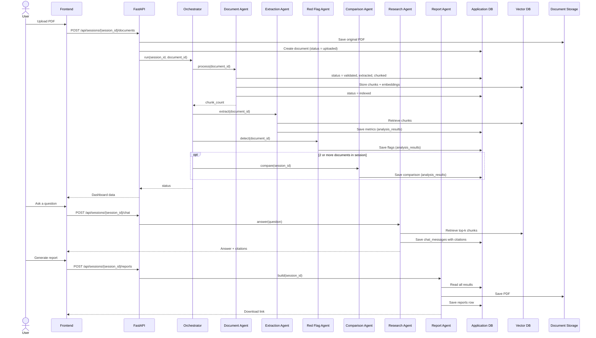
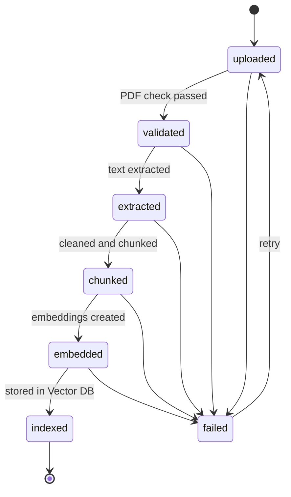
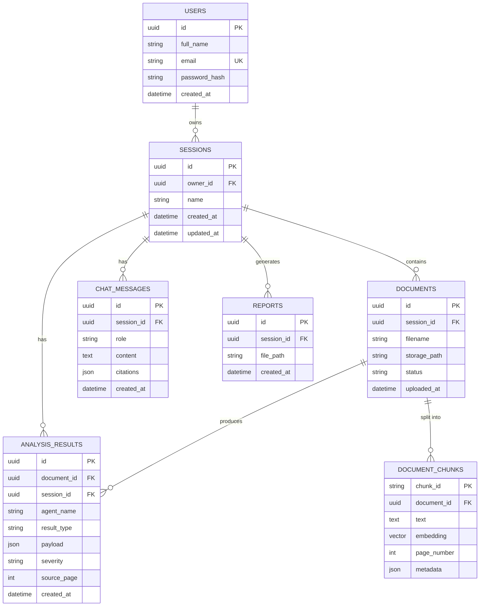

# FinSight AI: Multi-Agent Architecture Design

**Task 2 deliverable:** multi-agent architecture, orchestration flow, agent responsibilities and data models.
**Status:** Draft for team review.

> **Naming note:** Table and field names below follow Task 3 (`research-workspace-session-management`), which uses `sessions` and `session_id` in its REST APIs. If Task 3's SQLAlchemy models differ, Task 3 wins and this document should be updated.

---

## 1. Overview

FinSight AI is a multi-agent platform for financial analysts. A user logs in, creates a named research session, uploads financial PDFs (annual reports, 10-K filings, earnings transcripts) and gets back metrics, risk flags, company comparisons, cited answers and an analyst-style PDF report.

The system is split into six layers (from the HLD):

| # | Layer | Contents |
|---|---|---|
| 1 | Presentation | HTML + CSS + JavaScript frontend, dashboard, upload, chat, reports |
| 2 | Application and Orchestration | FastAPI backend, JWT + Argon2 auth, session management, Multi-Agent Orchestrator |
| 3 | Document Processing | Document Agent: validation, text extraction, cleaning, chunking, embeddings |
| 4 | Data and Storage | Application DB, Document Storage, Vector DB |
| 5 | Specialized AI Agents | Extraction, Red Flag, Comparison, Research, Report |
| 6 | Output | Metrics, risks, comparisons, cited answers, PDF report |

---

## 2. Agent Roster and Responsibilities

| Agent | Responsibility | Input | Output | Stored in |
|---|---|---|---|---|
| **Document Agent** | Validate PDF, extract text, clean, chunk, embed, index | Uploaded PDF | Chunks + embeddings | Vector DB, Document Storage, `documents.status` |
| **Extraction Agent** | Extract financial metrics and ratios | Chunks / PDF text | Metrics with source page | `analysis_results` |
| **Red Flag Agent** | Detect risks and anomalies | Metrics + chunks | Flags with severity and evidence | `analysis_results` |
| **Comparison Agent** | Benchmark companies and periods | Metrics of 2+ documents in the same session | Comparison table | `analysis_results` |
| **Research Agent** | Answer questions with citations (RAG) | User question + retrieved chunks | Answer with page citations | `chat_messages` |
| **Report Agent** | Assemble the analyst-style PDF | All stored results | PDF file | Document Storage, `reports` |

### What each agent must NOT do

**Document Agent**
- Must not interpret or analyze financial content.
- Must not call any other agent.
- Must not index a document that failed validation.
- Must not delete the original PDF, even if processing fails.

**Extraction Agent**
- Must not guess numbers. Every metric needs a source page, otherwise it is skipped.
- Must not judge whether a number is good or bad (that is the Red Flag Agent's job).
- Must not read the PDF directly if chunks are available.

**Red Flag Agent**
- Must not invent flags without evidence (quote or page reference required).
- Must not re-extract metrics. It reads the Extraction Agent's results.
- Must not compare companies.

**Comparison Agent**
- Must not compare documents from different sessions.
- Must not compare metrics with different periods or currencies without flagging it.
- Must not re-run extraction.

**Research Agent**
- Must not answer without retrieved chunks. If nothing relevant is found, it says so.
- Must not give an answer without at least one citation (document + page).
- Must not use knowledge outside the user's session documents for factual claims.

**Report Agent**
- Must not re-analyze or call an LLM to produce new findings. It only assembles existing results.
- Must not modify stored results.
- Must not include data from other sessions.

---

## 3. Orchestration Flow

### 3.1 Multi-Agent Orchestrator

The orchestrator is a service inside the FastAPI backend (`backend/services/orchestrator.py`). It:

1. Receives `session_id` and `document_id` from an API route.
2. Builds the shared state (section 3.3).
3. Runs the agents in order, passing state forward.
4. Updates `documents.status` after every step.
5. Saves each agent's result to the database.
6. Returns a final status: `completed`, `partial` or `failed`.

### 3.2 Execution order

```
Document -> Extraction -> Red Flag -> Comparison -> Report
                                         Research (on demand, from chat)
```

- **Batch run** (after upload): Document, Extraction, Red Flag. Comparison runs only if the session has 2 or more indexed documents.
- **On demand:** Research Agent runs every time the user sends a chat message.
- **On demand:** Report Agent runs when the user clicks "Generate Report".

### 3.3 Shared state

```json
{
  "session_id": "uuid",
  "document_ids": ["uuid"],
  "current_document_id": "uuid",
  "status": "running",
  "results": {
    "document": { "chunk_count": 0 },
    "extraction": { "metrics": [] },
    "red_flag": { "flags": [] },
    "comparison": { "table": [] }
  },
  "errors": [
    { "agent": "extraction", "message": "", "attempts": 0 }
  ],
  "started_at": "datetime"
}
```

Each agent reads from `results` and writes only to its own key.

### 3.4 Sequence diagram



### 3.5 Error handling

| Situation | Behavior |
|---|---|
| Agent fails (LLM error, timeout) | Retry up to **3 times** with exponential backoff (2s, 4s, 8s) |
| Document Agent fails after retries | Stop the pipeline. `documents.status = failed`. Original PDF is kept. |
| Extraction fails after retries | Stop the pipeline for that document, mark `failed`. Later agents depend on it. |
| Red Flag fails after retries | Continue. Mark run as `partial`. Dashboard shows "risk analysis unavailable". |
| Comparison fails after retries | Continue. Mark run as `partial`. |
| Research fails | Return an error message to chat. Nothing else is affected. |
| Report fails | Return an error. User can retry. Stored results are untouched. |
| Timeouts | Document Agent: 120s, other agents: 60s per attempt, Report Agent: 90s |

Every failure is written to `errors` in the shared state and logged with `document_id`, agent name and attempt number.

### 3.6 Document status lifecycle



---

## 4. Data Models

### 4.1 `users`

| Field | Type | Key / Notes |
|---|---|---|
| id | UUID | PK |
| full_name | String(100) | Required (register form) |
| email | String(255) | Unique, indexed |
| password_hash | String(255) | Argon2 hash |
| created_at | DateTime | Default now |

### 4.2 `sessions` (research workspace)

| Field | Type | Key / Notes |
|---|---|---|
| id | UUID | PK |
| owner_id | UUID | FK to users.id (Task 3 mentions an `owner_id` column) |
| name | String(150) | Session name |
| created_at | DateTime | |
| updated_at | DateTime | |

### 4.3 `documents`

| Field | Type | Key / Notes |
|---|---|---|
| id | UUID | PK |
| session_id | UUID | FK to sessions.id |
| filename | String(255) | Original name |
| storage_path | String(500) | Path in Document Storage |
| status | Enum | uploaded, validated, extracted, chunked, embedded, indexed, failed |
| error_message | Text | Nullable |
| page_count | Integer | Nullable |
| uploaded_at | DateTime | |

### 4.3b `analysis_results`

| Field | Type | Key / Notes |
|---|---|---|
| id | UUID | PK |
| document_id | UUID | FK to documents.id (nullable for session-level comparisons) |
| session_id | UUID | FK to sessions.id |
| agent_name | Enum | extraction, red_flag, comparison |
| result_type | String(50) | metric, flag, comparison_row |
| payload | JSON | Agent-specific content |
| severity | Enum | high, medium, low (Red Flag only, otherwise null) |
| source_page | Integer | Page in the PDF |
| created_at | DateTime | |

### 4.4 `chat_messages`

| Field | Type | Key / Notes |
|---|---|---|
| id | UUID | PK |
| session_id | UUID | FK to sessions.id |
| role | Enum | user, assistant |
| content | Text | |
| citations | JSON | List of `{document_id, page, chunk_id}` |
| created_at | DateTime | |

### 4.5 `reports`

| Field | Type | Key / Notes |
|---|---|---|
| id | UUID | PK |
| session_id | UUID | FK to sessions.id |
| file_path | String(500) | PDF in Document Storage |
| created_at | DateTime | |

### 4.6 Vector DB collection: `document_chunks`

| Field | Type | Notes |
|---|---|---|
| chunk_id | String | Unique ID |
| document_id | UUID | Links back to `documents.id` |
| session_id | UUID | Used to filter retrieval to one session |
| text | Text | Chunk content |
| embedding | Vector | Created by the embedding model |
| page_number | Integer | For citations |
| metadata | JSON | Section name, chunk index, company, fiscal year |

### 4.7 ER diagram



`DOCUMENT_CHUNKS` lives in the Vector DB, not the SQL database. The link to `documents` is logical (by `document_id`).

---

## 5. Agent Contracts (JSON)

### Document Agent

```json
// Input
{ "document_id": "uuid", "storage_path": "storage/pdfs/abc.pdf" }

// Output
{ "document_id": "uuid", "status": "indexed", "page_count": 120, "chunk_count": 340 }
```

### Extraction Agent

```json
// Input
{ "document_id": "uuid" }

// Output
{
  "document_id": "uuid",
  "metrics": [
    { "name": "Revenue", "value": 1250000000, "unit": "USD", "period": "FY2025", "source_page": 45 },
    { "name": "Net Profit Margin", "value": 12.4, "unit": "percent", "period": "FY2025", "source_page": 47 }
  ]
}
```

### Red Flag Agent

```json
// Input
{ "document_id": "uuid", "metrics": [] }

// Output
{
  "document_id": "uuid",
  "flags": [
    {
      "title": "Rising debt-to-equity ratio",
      "severity": "high",
      "evidence": "Debt-to-equity rose from 0.8 to 1.6 year over year.",
      "source_page": 52
    }
  ]
}
```

### Comparison Agent

```json
// Input
{ "session_id": "uuid", "document_ids": ["uuid-a", "uuid-b"] }

// Output
{
  "table": [
    { "metric": "Revenue", "values": { "uuid-a": 1250000000, "uuid-b": 980000000 }, "period": "FY2025" }
  ],
  "warnings": ["Currencies differ between documents"]
}
```

### Research Agent

```json
// Input
{ "session_id": "uuid", "question": "What was the revenue growth in FY2025?" }

// Output
{
  "answer": "Revenue grew 12% year over year to 1.25B USD.",
  "citations": [ { "document_id": "uuid", "page": 45, "chunk_id": "c-123" } ]
}
```

### Report Agent

```json
// Input
{ "session_id": "uuid" }

// Output
{ "report_id": "uuid", "file_path": "storage/reports/session-uuid.pdf" }
```

---

## 6. Shared Helpers

Used by all agents (from the LLD "Shared Helpers" box):

- **Prompt templates:** one template per agent, stored in `backend/services/prompts/`.
- **Retry logic:** a common decorator implementing the policy in section 3.5.
- **Model references:** a single config file naming the LLM and the embedding model, so they can be changed in one place.
- **Logging:** structured logs with `session_id`, `document_id`, `agent_name`.

---

## 7. Technology Choices

| Area | Choice | Reason |
|---|---|---|
| Backend | FastAPI (Python) | Per HLD, async, auto API docs |
| Application DB | SQLite (development), PostgreSQL (production) | Per HLD; SQLAlchemy for both |
| ORM | SQLAlchemy + Pydantic schemas | Matches Task 3 folders `models` and `schemas` |
| Vector DB | **ChromaDB** (proposed) | Free, runs locally, simple for a student project |
| Auth | JWT + Argon2 | Per HLD |
| PDF parsing | PyMuPDF or pdfplumber | Text and table extraction |
| Frontend | HTML + CSS + JavaScript | Per HLD |
| Report PDF | ReportLab or WeasyPrint | Python PDF generation |

---

## 8. Open Questions for the Team

1. Confirm the table name `sessions` vs `workspaces` with Task 3.
2. Confirm ChromaDB as the vector database.
3. Which LLM and embedding model will be used?
4. Is the Comparison Agent triggered automatically or by a user button?
